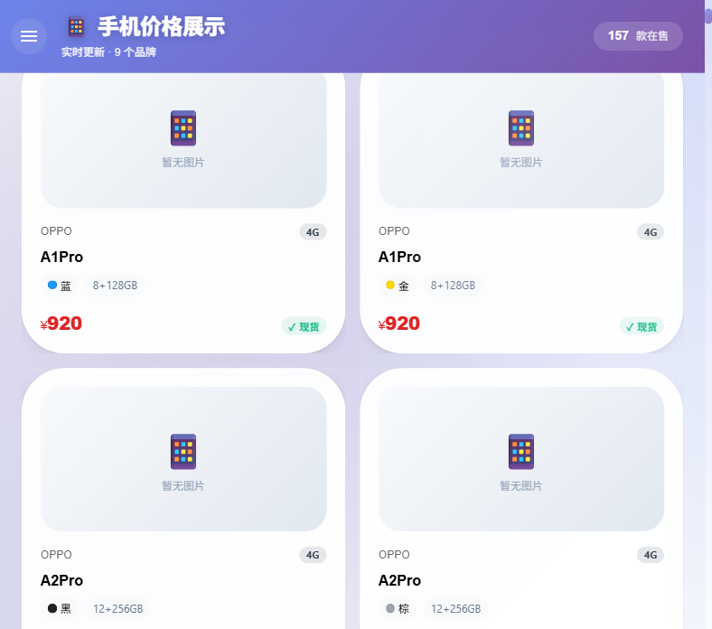
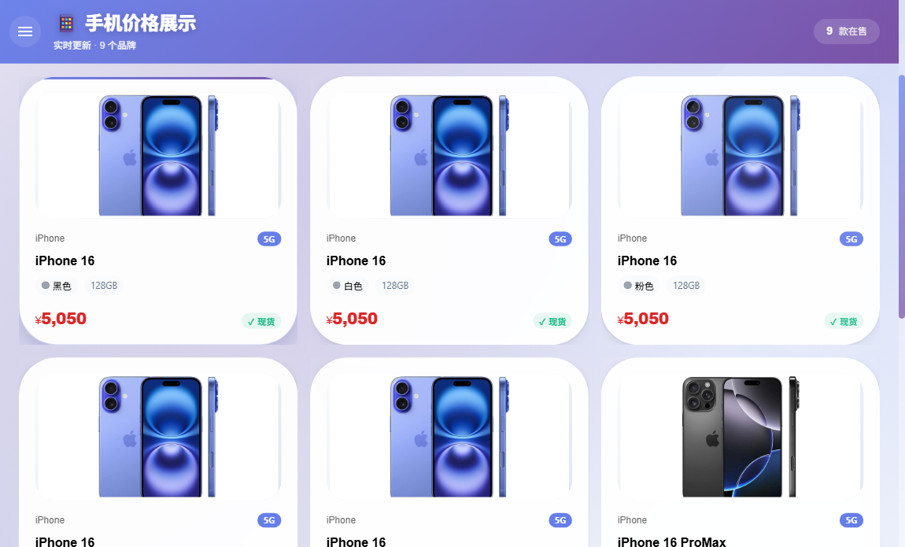

<div align="center">


# PhonePriceVista · 手机比价

**把一张手机批发报价单，变成可筛选、可比价的网页**

React 18 · TypeScript · MUI 5 ｜ 157 款机型 · 9 个品牌 ｜ 不接后端也能跑

[在线体验](https://aiyangdie.github.io/PhonePriceVista/) · [界面截图](#界面) · [快速开始](#快速开始) · [项目结构](#项目结构)


</div>

## 界面

<div align="center">
  
  
</div>

左：全部机型按品牌分组，每张卡片给出网络制式、存储配置、颜色、报价和库存状态。
右：按品牌筛到 iPhone，价格从 5050 到 8650 一眼看全。

## 为什么做这个

手机批发每天发一张报价单，长这样：

```
Reno13 16+256 5g 2485现货
Reno13 12+256 5g  2075现货
FindX8 12+256  5g黑3350¥
A3Pro  12+256 青1365￥
```

型号、配置、颜色、价格、有没有货，全挤在一行文字里。想知道某个型号现在什么价、哪个颜色还有货，只能一行行翻。

PhonePriceVista 做的事很直接：把这段文字拆成结构化字段，变成能查、能筛、能比的页面。

- 原始报价单 → 157 个可查询的 SKU，9 个品牌
- 型号、RAM、存储、颜色、价格、网络制式、库存状态拆成独立字段
- 同型号不同颜色并列，价差一眼看出来

## 功能

| 能力 | 说明 |
|---|---|
| 多品牌筛选 | OPPO、iPhone、iQOO、realme、vivo、一加、华为、红米、荣耀 |
| 实时搜索 | 输型号、品牌或颜色，300ms 防抖后即时出结果 |
| 价格区间 | 双滑块收窄，和品牌筛选叠加生效 |
| 排序 | 默认排序、价格升序、价格降序 |
| 库存状态 | 现货、怕抓、没货、原封，能不能发一眼看清 |
| 机型详情 | 点卡片看完整参数 |
| 数据管理 | 内置后台界面，可增删改机型与报价 |
| 可选爬虫 | 接后端后可抓 GSMArena 补参数与图片 |

## 两种运行方式

**方式一：纯前端（默认）**
报价数据已内置在前端，`npm run dev` 直接可用。适合展示、演示，也适合当一份可以随时查的价目表。

**方式二：接后端（可选）**
启动 `server/` 里的 Node 服务，前端检测到接口可用会自动切到接口模式，解锁数据管理、爬虫补图和图片代理。

## 快速开始

```bash
git clone https://github.com/aiyangdie/PhonePriceVista.git
cd PhonePriceVista
npm install
npm run dev
```

打开 `http://localhost:3000` 就能看到完整界面，不需要配置数据库。

需要后端能力时：

```bash
cd server
npm install
npm run dev
```

后端默认跑在 `http://localhost:3001`，数据库连接见 `server/.env.example`。前端通过 `.env` 里的 `REACT_APP_API_URL` 指向接口地址。

## 项目结构

```
src/
  App.tsx              页面主体与筛选逻辑
  data/phones.ts       内置报价数据（结构化）
  components/          后台管理面板
  services/api.ts      接口封装与超时控制
  utils/parseData.ts   报价单文本解析
server/
  routes/              机型、报价、爬虫接口
  services/            爬虫与定时任务
  database/            MySQL 表结构与导入脚本
public/                静态资源与原始报价单
```

## 数据说明

仓库里的报价来自一份 2025 年 5 月的批发单原件，价格是当时的批发价，仅供演示与查询结构参考。实际采购请以渠道当日报价为准。

## 许可证

[MIT](LICENSE)
